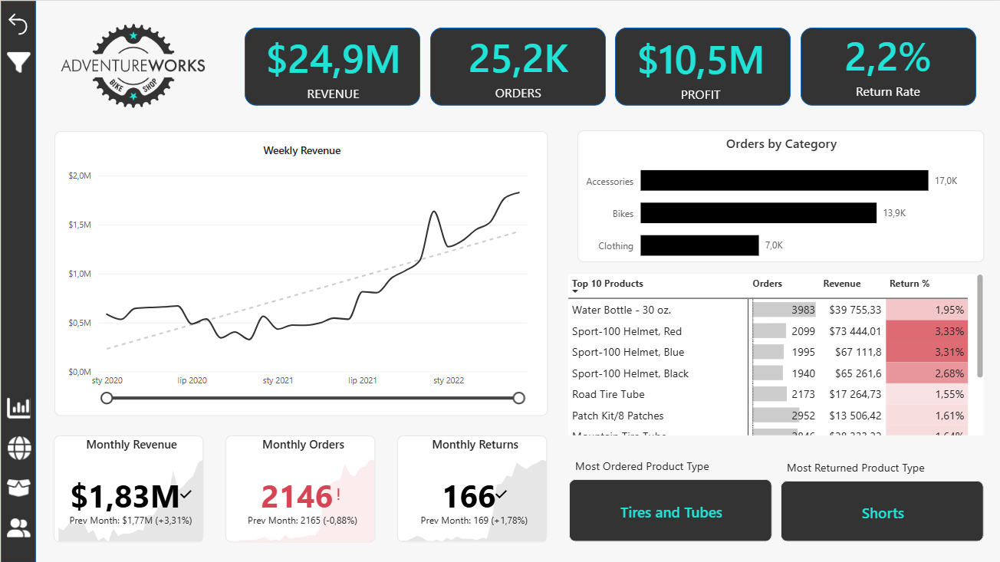
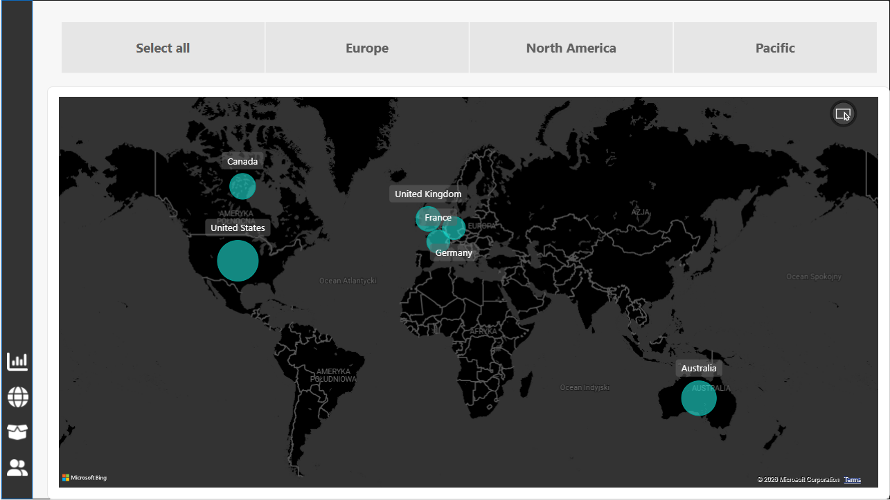
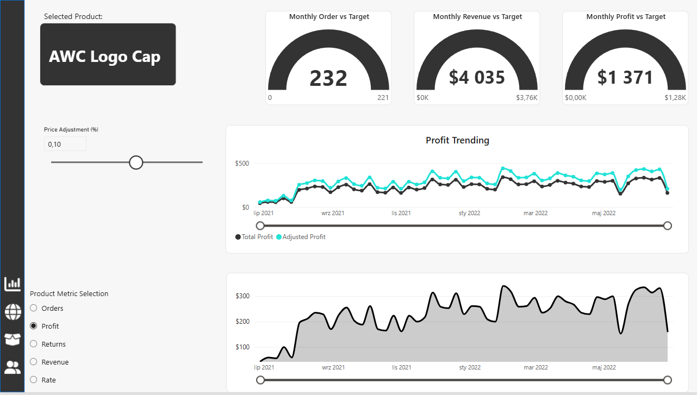
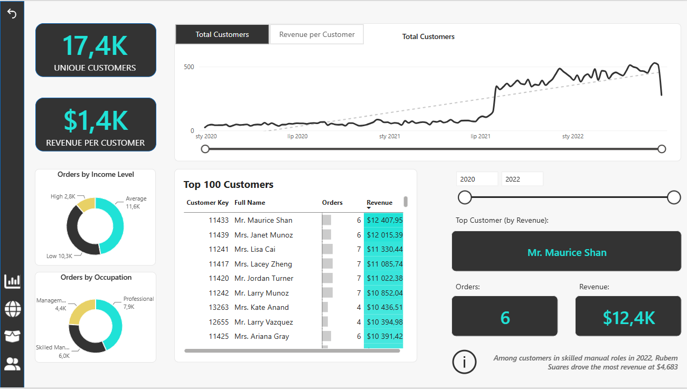
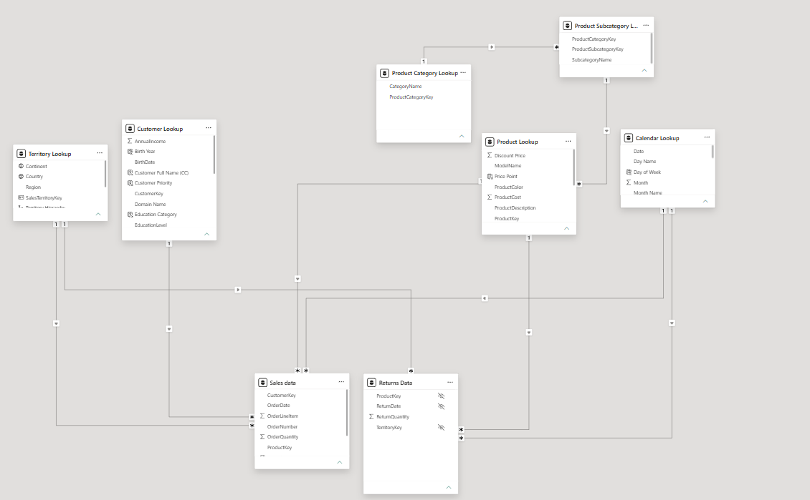

# AdventureWorks – Power BI Sales Report

🇬🇧 English | 🇵🇱 [Polski](README.md)

An interactive Power BI report for **AdventureWorks**, a fictional bike retailer. It covers sales, profit, returns, geographic distribution and customer profiles for 2020–2022.

## Table of contents
- [Report pages](#report-pages)
- [Data model](#data-model)
- [Key measures](#key-measures)
- [Techniques used](#techniques-used)
- [How to open](#how-to-open)

## Report pages

### 1. Exec Dashboard
A high-level summary for management.
- KPI cards: revenue (**$24.9M**), orders (**25.2K**), profit (**$10.5M**) and return rate (**2.2%**)
- Current-month KPIs for revenue, orders and returns, compared with the previous month
- Revenue over time with a trend line and a date range slider
- Orders by product category, with a custom tooltip showing category details
- **Top 10 products** matrix with data bars and conditional formatting on the return rate
- Most ordered and most returned product type
- Filter panel (year, continent) opened with a button

### 2. Map
A bubble map where bubble size shows the number of orders per country. Buttons above the map filter by continent (Europe, North America, Pacific).

### 3. Product Detail
Drill-down into a single product.
- Gauges: monthly orders, revenue and profit against target
- **Price Adjustment**: a what-if slider that simulates a price change. The *Profit Trending* chart compares actual profit with adjusted profit
- **Product Metric Selection**: switches the trend chart between orders, profit, returns, revenue and return rate

### 4. Customer Detail
Customer profile.
- Unique customers (**17.4K**) and revenue per customer (**$1.4K**)
- Trend over time with *Total Customers* / *Revenue per Customer* tabs
- Orders by income level and by occupation
- **Top 100 customers** table, plus cards for the top customer (orders, revenue)
- Year range slider and an auto-generated text summary (smart narrative)

### 5. Category Tooltip
A hidden page used as a custom tooltip on the category chart. It shows weekly orders plus revenue, profit, returns and return rate for the hovered category.

## Data model

A star schema: two fact tables (sales and returns) linked to lookup tables through one-to-many relationships. The product hierarchy is split across three tables (category → subcategory → product), forming a snowflake branch.

| Type | Tables |
|---|---|
| Facts | `Sales Data` (appended from `Sales Data 2020`, `2021`, `2022`), `Returns Data` |
| Dimensions | `Calendar Lookup`, `Customer Lookup`, `Product Lookup`, `Product Subcategory Lookup`, `Product Category Lookup`, `Territory Lookup` |
| Supporting | `Measure Table`, `Rolling Calendar`, `Price Adjustment`, `Product Metric Selection`, `Customer Metric Selection` |

## Key measures

All measures live in a dedicated `Measure Table`.

| Area | Measures |
|---|---|
| Sales | Total Revenue, Total Profit, Total Orders, Adjusted Profit |
| Returns | Total Returns, Return Rate |
| Customers | Total Customers, Revenue per Customer |
| Time comparisons | Previous Month Revenue / Orders / Returns |
| Targets | Revenue Target, Profit Target, Order Target |

## Techniques used
- Appending yearly data files in Power Query
- Star schema with a dedicated calendar table and date hierarchy
- Calculated columns, e.g. `Customer Full Name`, `Customer Priority`, `Education Category`, `Birth Year`, `Discount Price`, `Price Point`
- DAX measures with time intelligence (previous-month comparisons, targets)
- What-if parameter for price simulation
- Field parameters for switching chart metrics
- Conditional formatting, data bars, trend lines
- Report page tooltip
- Button navigation and bookmarks, including a filter panel

## How to open
1. Install [Power BI Desktop](https://www.microsoft.com/power-platform/products/power-bi/desktop) (free, Windows).
2. Download the repository and open `AdventureWorks.pbix`.

The data is imported into the file, so the report works without connecting to any data source.

## Data
AdventureWorks is a fictional sample dataset published by Microsoft. It contains no real company or personal data.

## Author
**Grzegorz Wilkowiecki** · [LinkedIn](www.linkedin.com/in/grzegorz-wilkowiecki-471a01200)
