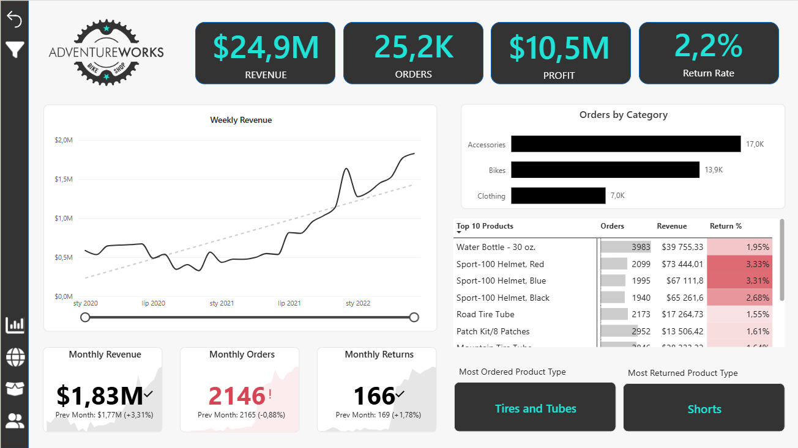
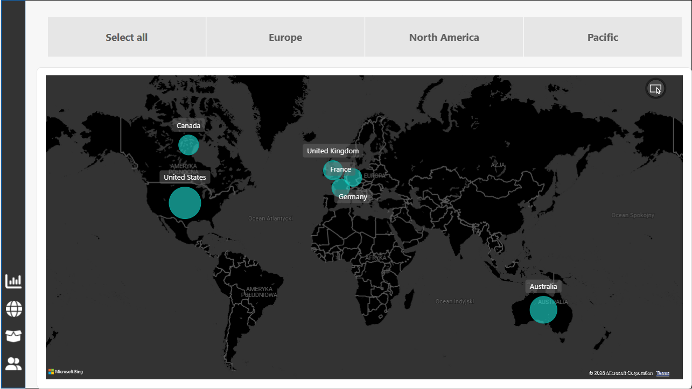
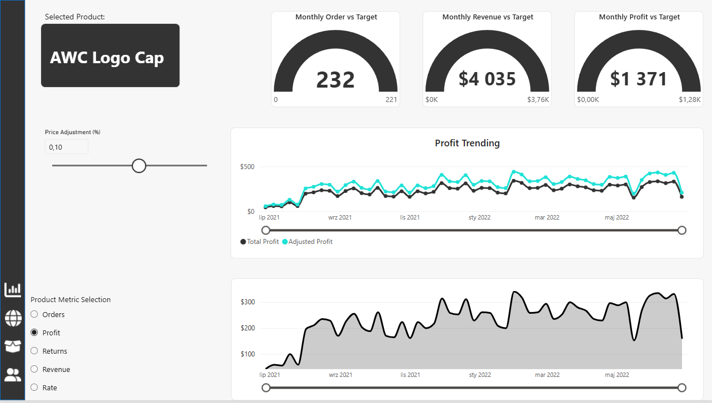
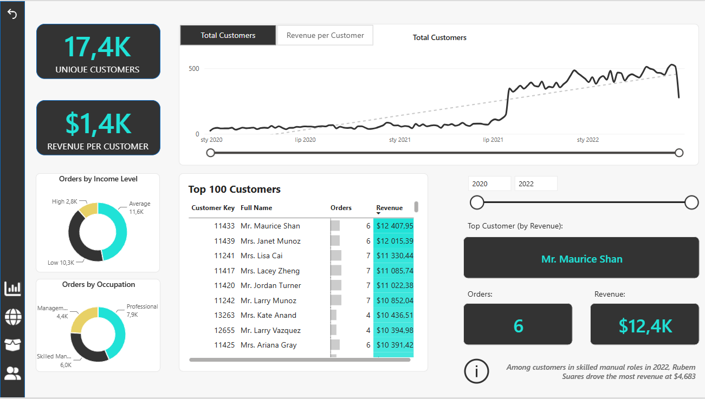
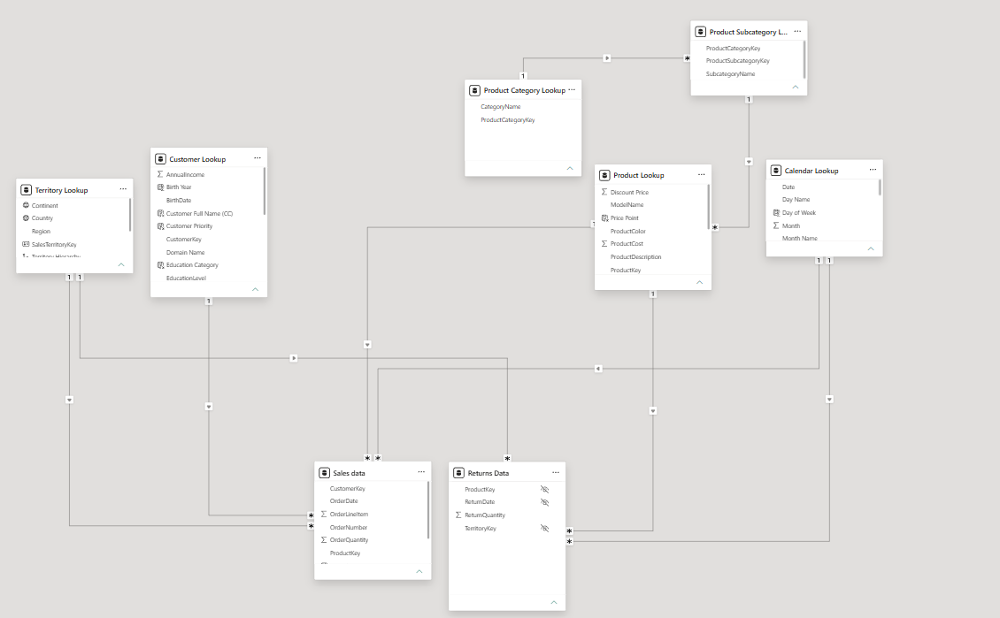

# AdventureWorks – raport sprzedażowy w Power BI

Interaktywny raport Power BI dla fikcyjnej firmy rowerowej **AdventureWorks**. Pokazuje sprzedaż, zyski, zwroty, rozkład geograficzny i profil klientów w latach 2020–2022.

## Spis treści
- [Strony raportu](#strony-raportu)
- [Model danych](#model-danych)
- [Kluczowe miary](#kluczowe-miary)
- [Użyte techniki](#użyte-techniki)
- [Jak uruchomić](#jak-uruchomić)

## Strony raportu

### 1. Exec Dashboard
Podsumowanie dla zarządu.
- Karty KPI: **Total Revenue**, **Total Profit**, **Total Orders**, **Return Rate**
- Wskaźniki KPI miesiąc do miesiąca: przychód, zamówienia, zwroty (w porównaniu z poprzednim miesiącem)
- Trend przychodu w czasie (rok → kwartał → miesiąc)
- Zamówienia według kategorii produktów, z tooltipem pokazującym szczegóły kategorii
- Macierz **Top 10 produktów** (zamówienia, przychód, wskaźnik zwrotów)
- Filtry: rok i kontynent

### 2. Map
Mapa zamówień według krajów z filtrem kontynentu.

### 3. Product Detail
Analiza pojedynczego produktu.
- Wskaźniki zegarowe: miesięczny przychód, zysk i liczba zamówień w porównaniu z celem
- Trend zysku z porównaniem do **zysku skorygowanego** (parametr „what-if” do symulacji zmiany ceny)
- Przełącznik metryki wyświetlanej na wykresach
- Trend zwrotów

### 4. Customer Detail
Profil klientów.
- Liczba unikalnych klientów i przychód na klienta
- Zamówienia według poziomu dochodów i zawodu
- Tabela **Top 100 klientów** i karta z danymi najlepszego klienta
- Trend liczby klientów w czasie z przełącznikiem metryki

### 5. Category Tooltip
Ukryta strona używana jako niestandardowy tooltip na wykresie kategorii: tygodniowe zamówienia oraz przychód, zysk, zwroty i wskaźnik zwrotów dla danej kategorii.

## Model danych

Model w schemacie gwiazdy: tabele faktów połączone z tabelami wymiarów (lookup).

| Typ | Tabele |
|---|---|
| Fakty | `Sales Data` (połączenie `Sales Data 2020`, `2021`, `2022`), `Returns Data` |
| Wymiary | `Calendar Lookup`, `Customer Lookup`, `Product Lookup`, `Product Subcategory Lookup`, `Product Category Lookup`, `Territory Lookup` |
| Pomocnicze | `Measure Table`, `Rolling Calendar`, `Price Adjustment`, `Product Metric Selection`, `Customer Metric Selection` |

## Kluczowe miary

Wszystkie miary są zebrane w osobnej tabeli `Measure Table`.

| Obszar | Miary |
|---|---|
| Sprzedaż | Total Revenue, Total Profit, Total Orders, Adjusted Profit |
| Zwroty | Total Returns, Return Rate |
| Klienci | Total Customers, Average Revenue per Customer |
| Porównania w czasie | Previous Month Revenue / Orders / Returns |
| Cele | Revenue Target, Profit Target, Order Target |

## Użyte techniki
- Łączenie kilku plików z danymi rocznymi w Power Query
- Model gwiazdy z osobną tabelą kalendarza i hierarchią dat
- Miary DAX z inteligencją czasową (porównania z poprzednim miesiącem, cele)
- Parametr „what-if” do symulacji zmiany ceny
- Parametry pól do przełączania metryk na wykresach
- Strona tooltipa
- Nawigacja przyciskami i zakładki (bookmarks), m.in. panel filtrów

## Jak uruchomić
1. Zainstaluj [Power BI Desktop](https://www.microsoft.com/power-platform/products/power-bi/desktop) (bezpłatny, Windows).
2. Pobierz repozytorium i otwórz plik `AdventureWorks.pbix`.

Dane są zaimportowane do pliku, więc raport działa bez podłączania źródeł.

## Dane
AdventureWorks to przykładowy, fikcyjny zbiór danych udostępniany przez Microsoft. Nie zawiera prawdziwych danych firm ani osób.

## Autor
**Grzegorz Wilkowiecki** · [LinkedIn](www.linkedin.com/in/grzegorz-wilkowiecki-471a01200)
